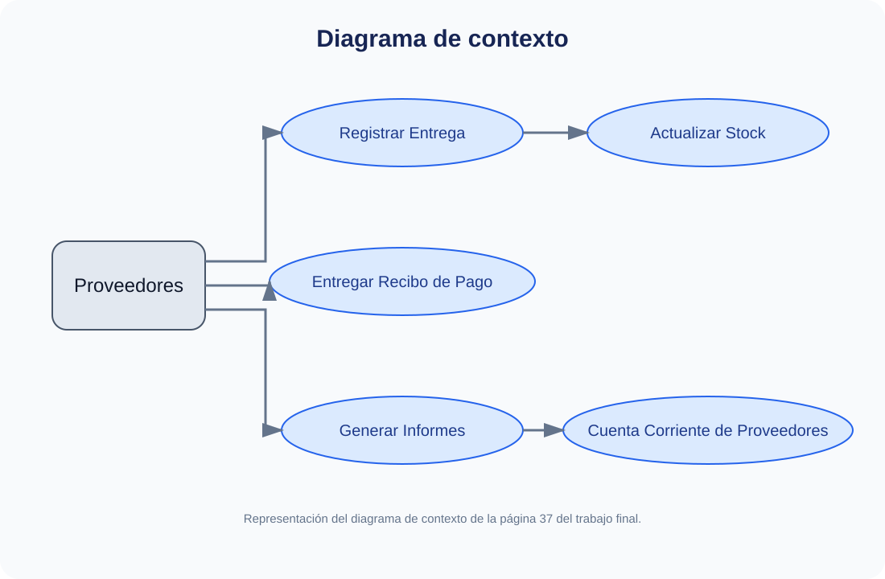
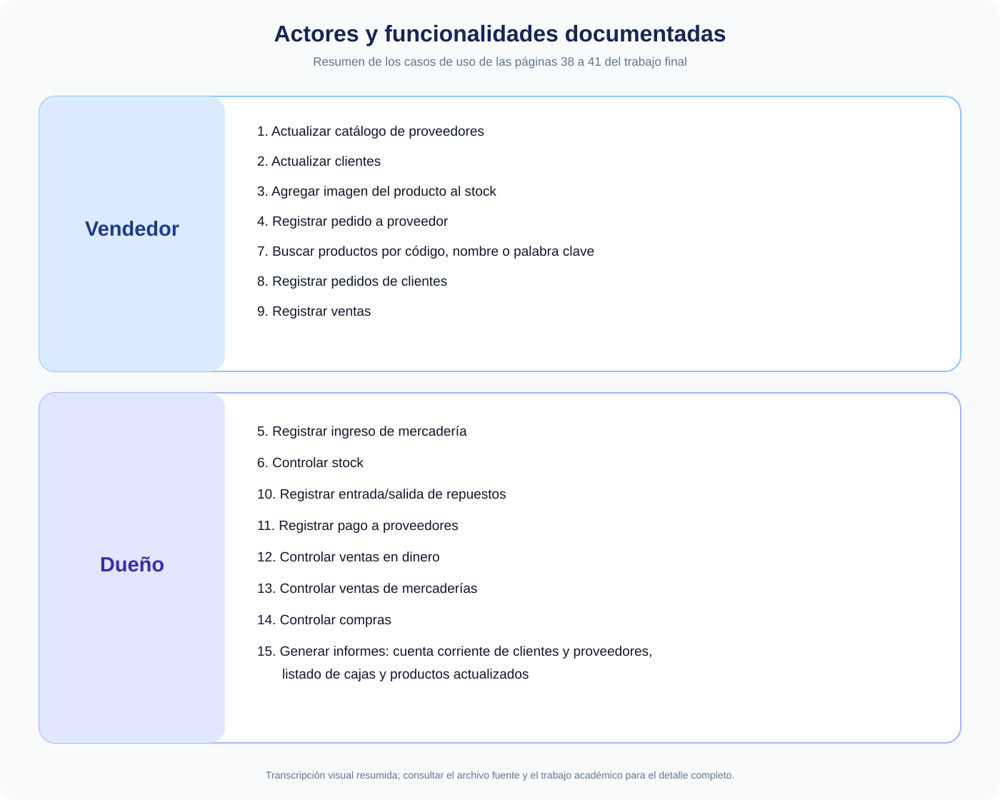
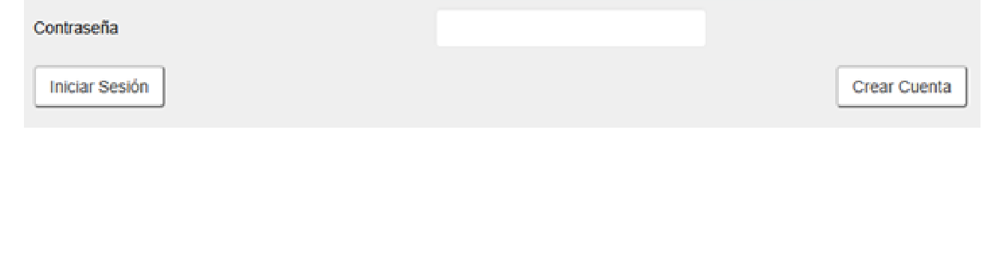
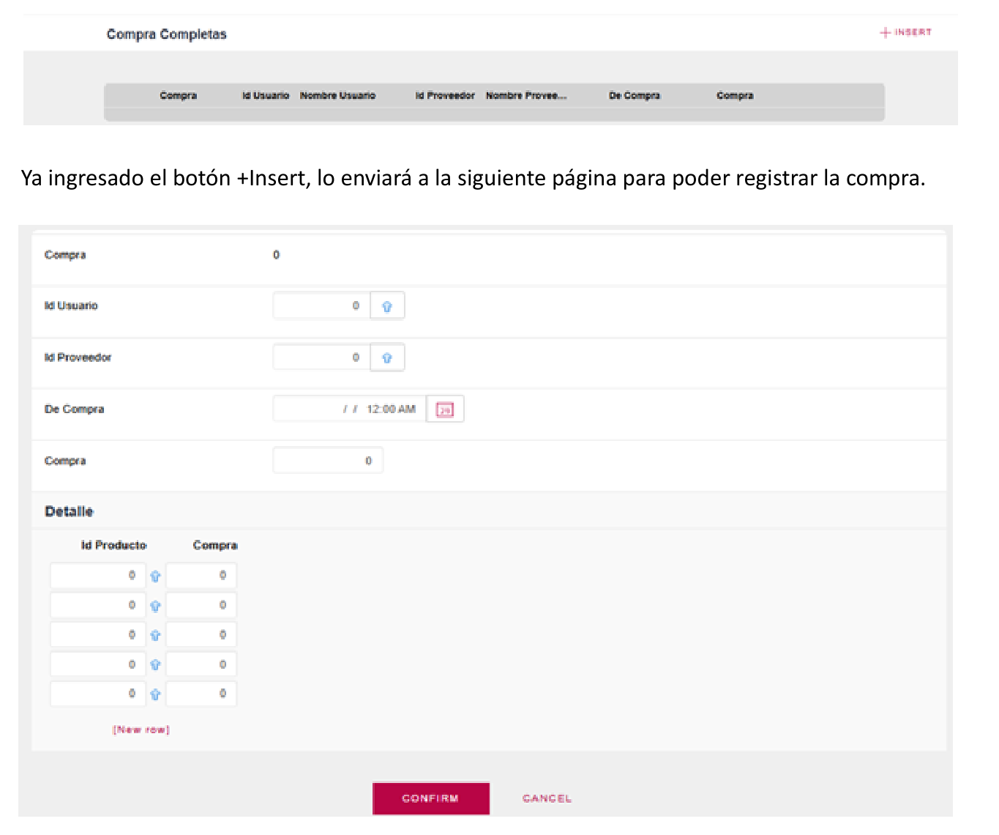
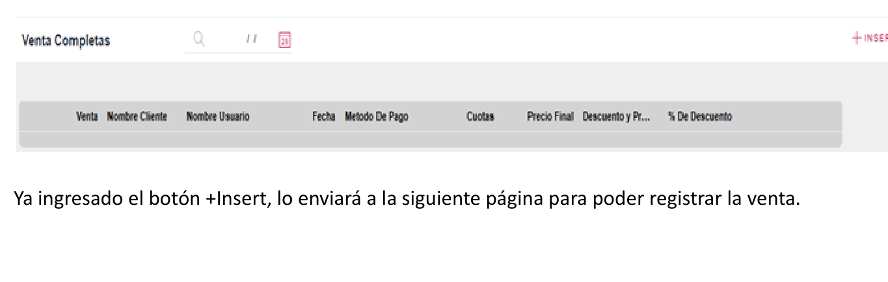
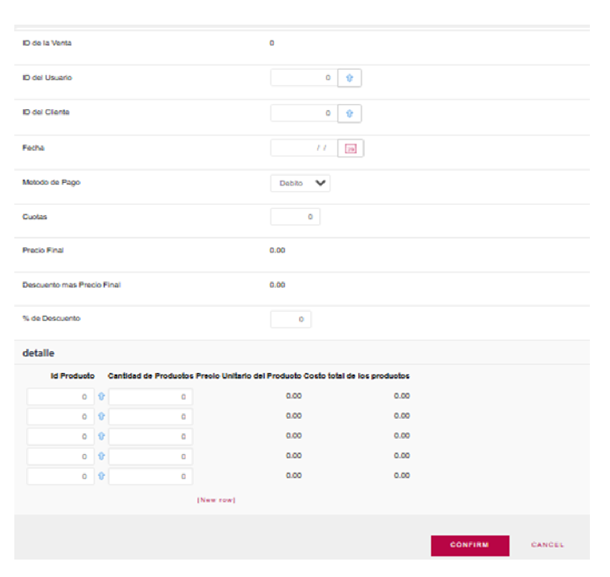

# Sistema de Gestión para Casa de Repuestos

Sistema de gestión administrativa y comercial desarrollado como Proyecto Final de la Tecnicatura Superior en Desarrollo de Software del Instituto Superior Brigadier López.

La solución fue diseñada para un comercio real de repuestos automotores, con el objetivo de digitalizar y organizar sus operaciones internas, que anteriormente se registraban de forma manual.

## Objetivo del proyecto

Desarrollar un sistema que permita centralizar la información comercial y mejorar la gestión de productos, inventario, ventas, compras, pedidos y cuentas corrientes.

El proyecto partió de entrevistas con el propietario del comercio para identificar necesidades, problemas operativos y requerimientos de la solución.

## Funcionalidades contempladas

El alcance funcional documentado comprende los siguientes módulos:

- **Gestión de productos:** alta, modificación, búsqueda y categorización de repuestos.
- **Control de stock:** seguimiento de existencias y actualización de inventario.
- **Ventas y facturación:** registro de operaciones, medios de pago y emisión de comprobantes.
- **Compras y proveedores:** registro de compras, ingresos de mercadería y pagos.
- **Gestión de pedidos:** seguimiento de pedidos de clientes y proveedores.
- **Cuentas corrientes:** registro de saldos, deudas y pagos.
- **Usuarios y permisos:** perfiles diferenciados de administrador y vendedor.
- **Reportes e informes:** información sobre ventas, compras, stock y cuentas corrientes.

## Tecnologías y herramientas

- **GeneXus:** entorno utilizado para el desarrollo de componentes de front-end y back-end.
- **Base de datos relacional:** estructura organizada para productos, clientes, proveedores, ventas y otras operaciones.
- **Herramientas de modelado:** diagramas de contexto, casos de uso y entidad-relación.
- **Microsoft Word:** documentación del proyecto.

## Mi participación

Mi principal participación estuvo orientada al análisis funcional y al diseño de la solución:

- Realicé entrevistas y relevamiento de necesidades con el propietario del comercio.
- Identifiqué problemas operativos y definí requerimientos funcionales y no funcionales.
- Elaboré documentación funcional y diagramas del sistema.
- Participé en el diseño de la estructura de datos y trabajé directamente en GeneXus creando y modificando tablas.
- Participé en el diseño de interfaces y componentes funcionales.
- Colaboré en pruebas, validación y correcciones del sistema.

El desarrollo fue realizado en equipo de dos integrantes, con responsabilidades compartidas y diferentes niveles de participación en las tareas de análisis y programación.

## Diagramas del proyecto

### Diagrama de contexto

*Fuente editable del mismo diagrama: [diagrama-contexto.mmd](diagrams/diagrama-contexto.mmd).*

### Actores y funcionalidades

*Fuente editable del mismo diagrama: [funcionalidades-y-actores.mmd](diagrams/funcionalidades-y-actores.mmd).*

## Capturas de pantalla

Las siguientes imágenes provienen del manual de usuario del proyecto académico. Son capturas de la documentación, no una demostración en vivo del sistema.

### Inicio de sesión

### Registro de compras

### Historial de ventas

### Registro de ventas

## Documentación del proyecto

- [Alcance funcional](docs/alcance-funcional.md)
- [Casos de uso e interacciones](docs/casos-de-uso.md)
- [Requerimientos funcionales y no funcionales](docs/requerimientos-funcionales-no-funcionales.md)
- [Análisis y modelado](docs/analisis-y-modelado.md)
- [Modelo de datos y diagrama entidad-relación](docs/modelo-de-datos.md)
- [Diagramas y pantallas](docs/diagramas-y-pantallas.md)
- [Notas del portfolio y privacidad](docs/portfolio-notes.md)

## Metodología de trabajo

Se utilizó un enfoque de desarrollo iterativo e incremental, organizando el trabajo en etapas de relevamiento, análisis, diseño, implementación, pruebas y validación.

## Contexto académico

- **Institución:** Instituto Superior Brigadier López
- **Carrera:** Tecnicatura Superior en Desarrollo de Software
- **Proyecto:** Trabajo Final de Carrera
- **Período:** 2024–2025

---

Este repositorio presenta una descripción y documentación seleccionada del proyecto académico. No incluye código fuente ni datos privados del comercio.
