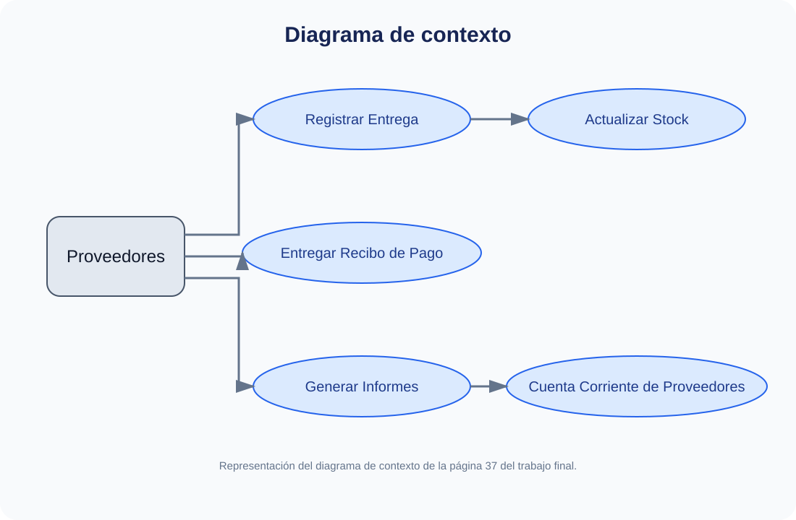
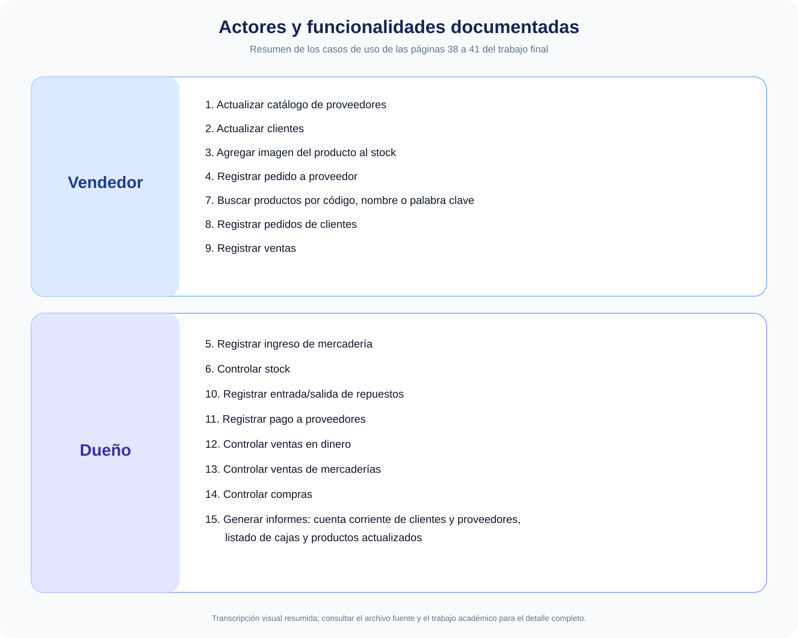

# Diagramas y pantallas del sistema

Esta sección presenta **dos diagramas distintos**. Cada uno tiene una versión visual SVG y un archivo fuente Mermaid editable. Los dos formatos dentro de cada pareja representan el mismo diagrama; no son diagramas adicionales.

## 1. Diagrama de contexto — página 37

Identifica al actor **Proveedores** y sus interacciones con el sistema:

- Registrar entrega.
- Actualizar stock como comportamiento incluido en el registro de entrega.
- Entregar recibo de pago.
- Generar informes.
- Consultar la cuenta corriente de proveedores.

- [Fuente editable Mermaid del mismo diagrama](../diagrams/diagrama-contexto.mmd)

## 2. Actores y funcionalidades — páginas 38 a 41

Resume los 15 casos de uso documentados para dos actores:

- **Vendedor:** funcionalidades 1, 2, 3, 4, 7, 8 y 9.
- **Dueño:** funcionalidades 5, 6, 10, 11, 12, 13, 14 y 15.

El actor Proveedores y sus interacciones se mantienen en el diagrama de contexto de la página 37, sin duplicarlos aquí.

- [Fuente editable Mermaid del mismo diagrama](../diagrams/funcionalidades-y-actores.mmd)

## 3. Interfaces documentadas

Las siguientes capturas se extrajeron del manual de usuario:

- [Inicio de sesión](../screenshots/01-login.png)
- [Registro de compras](../screenshots/02-registro-compra.png)
- [Historial de ventas](../screenshots/03-historial-ventas.png)
- [Registro de ventas](../screenshots/04-registro-venta.png)

También se pueden consultar todas juntas en el [README de capturas](../screenshots/README.md).

## Nota sobre el material

Los SVG son representaciones visuales transcritas para facilitar la lectura en el portfolio. No son exportaciones originales de GeneXus ni reemplazan los diagramas del documento académico. Los archivos Mermaid son las fuentes editables de esos mismos diagramas. Las capturas de interfaz provienen del manual incluido en el trabajo final.
