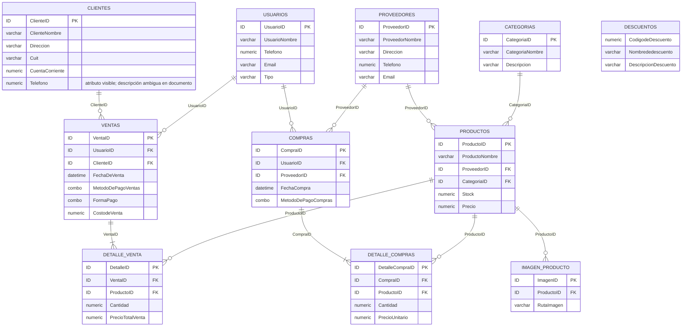

# Modelo de datos

## Alcance

Este documento resume el **modelo lógico de datos descrito en el trabajo final** (páginas 42 a 51). No representa una extracción de la base de datos física ni una inspección del proyecto GeneXus.

El trabajo documenta tablas, atributos y marcas de clave primaria (PK) y clave foránea (FK). El diagrama resume las relaciones que se pueden respaldar directamente con esas referencias. Las cardinalidades 1:N se representan a partir de la estructura PK/FK; deben leerse como interpretación del modelo relacional documentado.

## Diagrama entidad-relación

- [Abrir fuente Mermaid](../diagrams/modelo-entidad-relacion.mmd)

## Entidades documentadas

| Entidad | Clave primaria documentada | Claves foráneas documentadas |
|---|---|---|
| Clientes | ClienteID | — |
| Usuarios | UsuarioID | — |
| Ventas | VentaID | UsuarioID → Usuarios; ClienteID → Clientes |
| Detalle de Venta | DetalleID | VentaID → Ventas; ProductoID → Productos |
| Productos | ProductoID | ProveedorID → Proveedores; CategoriaID → Categorías |
| Categorías | CategoriaID | — |
| Proveedores | ProveedorID | — |
| Imagen del producto | ImagenID | ProductoID → Productos |
| Compras | CompraID | UsuarioID → Usuarios; ProveedorID → Proveedores |
| Detalle de Compras | DetalleCompraID | CompraID → Compras; ProductoID → Productos |
| Descuentos | No está identificada con claridad | No está identificada con claridad |

## Atributos principales

Los nombres se mantienen cercanos a los que aparecen en las tablas del documento. Se omiten tipos de datos cuando no están indicados con claridad.

### Clientes
- ClienteID (PK, ID).
- ClienteNombre (VarChar(70), NotNull).
- Dirección (VarChar(70), NotNull).
- Cuit (VarChar(30), NotNull).
- CuentaCorriente (Numeric(12.2), NotNull).
- Teléfono: aparece en la continuación de la tabla, pero la descripción del atributo dice “del Proveedor”. Se deja como dato a verificar.

### Usuarios
- UsuarioID (PK, ID).
- UsuarioNombre (VarChar(70), NotNull).
- Telefono (Numeric(15.0), NotNull).
- Email (VarChar(70), NotNull).
- Tipo (VarChar(30), NotNull).

### Ventas
- VentaID (PK, ID).
- UsuarioID (FK a Usuarios).
- ClienteID (FK a Clientes).
- FechaDeVenta (el documento escribe “DataTime”; se conserva la observación como posible error tipográfico).
- MetodoDePagoVentas (combo box).
- FormaPago (combo box).
- CostodeVenta (Numeric(10), NotNull).

### Detalle de Venta
- DetalleID (PK, ID).
- VentaID (FK a Ventas).
- ProductoID (FK a Productos).
- Cantidad (Numeric(4.0), NotNull).
- PrecioTotalVenta (precio discriminado por producto; el tipo de dato no queda indicado en la tabla).

### Productos
- ProductoID (PK, ID).
- ProductoNombre (VarChar(70), NotNull).
- ProveedorID (FK a Proveedores).
- CategoriaID (FK a Categorías).
- Stock (NotNull; tipo no especificado en la tabla).
- Precio (Numeric(12.2), NotNull).

### Categorías
- CategoriaID (PK, ID).
- CategoriaNombre (VarChar(100), NotNull).
- Descripción (VarChar(700), NotNull).

### Proveedores
- ProveedorID (PK, ID).
- ProveedorNombre (VarChar(70), NotNull).
- Direccion (VarChar(70), NotNull).
- Telefono (Numeric(15.0), NotNull).
- Email (VarChar(70), NotNull).

### Imagen del producto
- ImagenID (PK, ID).
- ProductoID (FK a Productos).
- RutaImagen (VarChar(260), NotNull).

### Compras
- CompraID (PK, ID).
- UsuarioID (FK a Usuarios; el documento tiene una errata de escritura en el nombre del atributo en una página).
- ProveedorID (FK a Proveedores).
- FechaCompra (DateTime, NotNull).
- MetodoDePagoCompras (combo box de texto, NotNull).

### Detalle de Compras
- DetalleCompraID (PK, ID).
- CompraID (FK a Compras).
- ProductoID (FK a Productos).
- Cantidad (Numeric(4.0), NotNull).
- PrecioUnitario (Numeric(12.4), NotNull).

### Descuentos
- CodigodeDescuento (Numeric(1.0), valores descriptos de 1 a 9).
- Nombrededescuento (Varchar(25), NotNull).
- DescripciónDescuento (Varchar(3), Null).
- La tabla no marca explícitamente una PK ni una FK en el cuadro consultado, por lo que no se incorpora una relación en el diagrama.

## Relaciones respaldadas por las FK del documento

- Una venta referencia un usuario y un cliente.
- Cada detalle de venta referencia una venta y un producto.
- Un producto referencia un proveedor y una categoría.
- Una imagen referencia un producto.
- Una compra referencia un usuario y un proveedor.
- Cada detalle de compra referencia una compra y un producto.

## Observaciones de calidad de datos del documento

Durante la transcripción se identificaron algunos puntos que conviene validar con el proyecto GeneXus original antes de afirmar que son el esquema implementado:

1. En Clientes, el campo Telefono aparece en la continuación de la tabla, pero su descripción menciona al proveedor.
2. En Ventas, el tipo de FechaDeVenta figura como “DataTime”, mientras que en Compras aparece “DateTime”.
3. PrecioTotalVenta no presenta un tipo de dato explícito en la tabla de Detalle de Venta.
4. La tabla Descuentos no deja claramente identificada una PK ni su relación con Productos.
5. En Compras, el nombre UsuarioID aparece con una errata tipográfica en una de las páginas.

Estas observaciones se conservan deliberadamente para no corregir ni completar el diseño original por suposición.

## Fuente

Trabajo Final de Carrera – Tecnicatura Superior en Desarrollo de Software, Instituto Superior Brigadier López, páginas 42–51.
